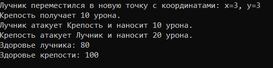

# Лабораторная работа №2
## Для демонстрации работы программы был проведён тест со следующими входными данными:
```python
archer = Archer(1, "Лучник", 0, 0, 100, 10)
fort = Fort(2, "Крепость", 5, 5, True, 20, 100)
mobile_home = MobileHome(3, "Мобильный дом", 10, 10, False)
archer.move(3, 3)
archer.attack(fort)
fort.attack(archer)
print(f"Здоровье лучника: {archer.get_hp()}")
print(f"Здоровье крепости: {fort.get_hp()}")
```
## Результат выполнения теста:
