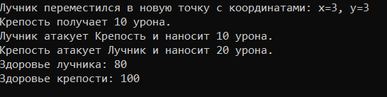

# Лабораторная работа №3
## Singleton (Одиночка)
### Пример использования
```python
car1 = Car("Mazda Capella")
car2 = Car("Toyota Camry")

print(car1 is car2) # True
car1.accelerate(50)
car2.accelerate(30)
print(f"Модель: {car1.model}, скорость: {car1.speed} км/ч")
print(f"Модель: {car2.model}, скорость: {car2.speed} км/ч")
```
## Factory Method (Фабричный метод)
```python
dist = Dist_auto()
auto = dist.zapusk()
print(auto.zavesti())
```
## Abstract factory (Абстрактная фабрика)
```python
def client_code(factory: TransportFactory):
    car = factory.create_car()
    bike = factory.create_bike()
    print(car.drive())
    print(bike.ride())

print("Mazda:")
client_code(MazdaFactory())
print("Toyota:")
client_code(ToyotaFactory())
```

## Builder (Строитель)
```python
builder = ComputerBuilder()
pc = builder.set_cpu("Intel i5").set_ram(16).set_storage(512).build()
print(pc)
```
